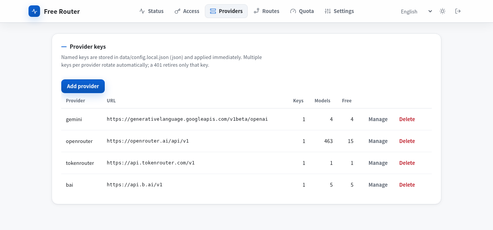
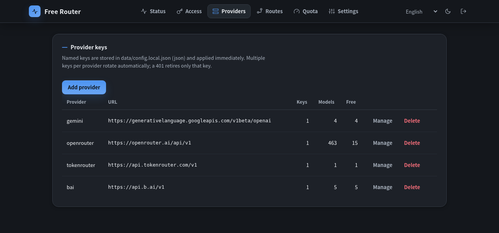
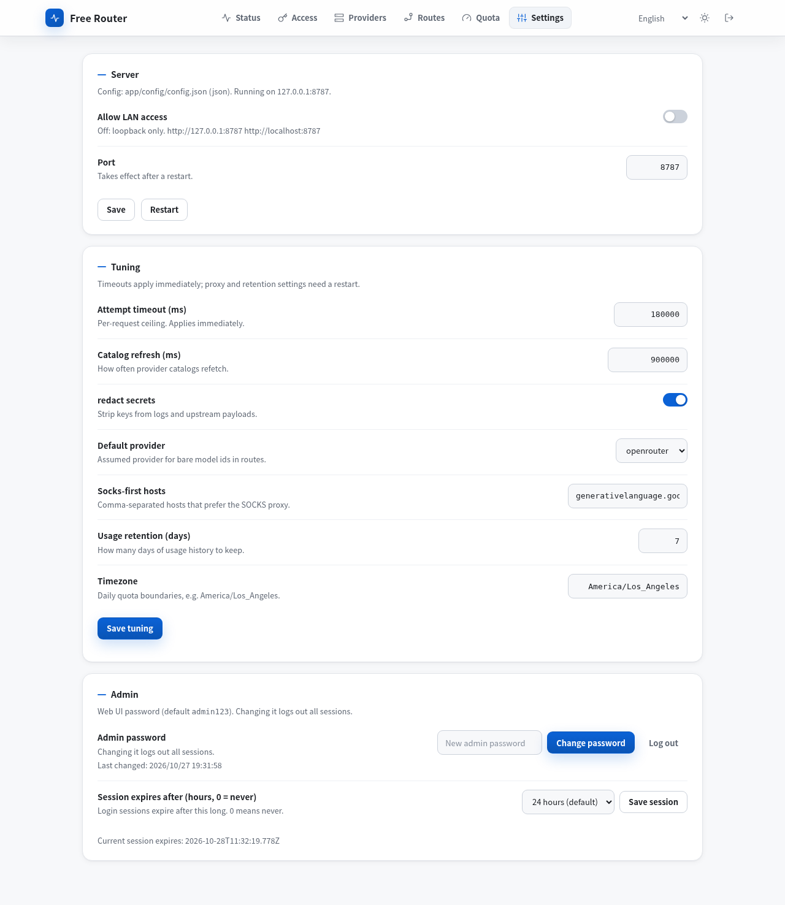
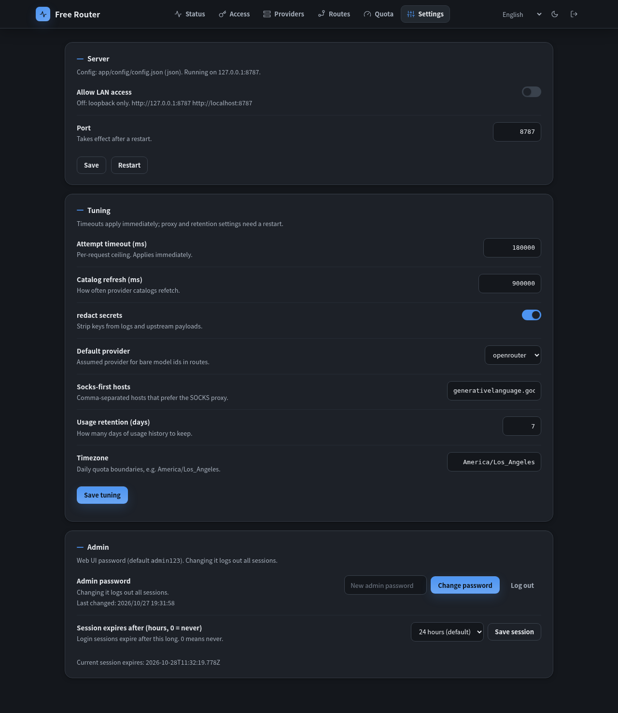

# Free Router Plus

> English | [中文](docs/zh-CN/README.md)

<p align="center">
  
</p>

Turn scattered **free-tier models** into one **inexhaustible OpenAI endpoint**. Point any client at it and call `free-best`: when a model is rate-limited, down, or out of quota, the next one takes over automatically.

- **Zero dependencies**: pure Node standard library. No `npm install`, no supply-chain baggage.
- **Works out of the box**: generates its own default config on first boot. Open the browser and configure.
- **Key freedom**: multiple keys per provider rotate automatically. A `401` retires only the bad one.
- **Transparent quotas**: free allowances tracked per day. Exhausted models step aside and return tomorrow.
- **LAN ready**: one switch plus gateway auth. Phones, tablets, and other machines at home can use it.
- **Speaks your language**: 12 UI languages, following the browser automatically.
- **Light and dark themes**: follow the system, or lock light/dark from the top bar.

## Screenshots

The web UI ships with light and dark themes; the top-bar button cycles follow-system → light → dark. Every setting below applies to the running process immediately unless it is marked restart-only.

| Providers — light | Providers — dark |
| :---: | :---: |
|  |  |

| Settings — light | Settings — dark |
| :---: | :---: |
|  |  |

## Contents

- [Screenshots](#screenshots)
- [60-second start](#60-second-start)
- [Docker](#docker)
- [What it does behind the scenes](#what-it-does-behind-the-scenes)
- [Going further](#going-further)
- [Where to get keys](#where-to-get-keys)
- [`.env` (optional)](#env-optional)
- [Development](#development)
- [Upstream and fork](#upstream-and-fork)

## 60-second start

```bash
git clone https://github.com/sitaoo/free-router.git
cd free-router
./ctl.sh start          # Node 20+ only, nothing else needed
```

Open <http://127.0.0.1:8787/> and log in (default password `admin123`). Paste at least one key on the **Providers** tab, then:

```bash
curl http://127.0.0.1:8787/v1/chat/completions \
  -H 'Content-Type: application/json' \
  -d '{"model": "free-best", "messages": [{"role": "user", "content": "hi"}]}'
```

That is it. Route order, quotas, LAN access, gateway keys — the rest is all point-and-click in the UI. `./ctl.sh stop` stops it, `./ctl.sh status` checks it.

The same gateway also answers the OpenAI **Responses API**, translated to the chat dialect every provider understands:

```bash
curl http://127.0.0.1:8787/v1/responses \
  -H 'Content-Type: application/json' \
  -d '{"model": "free-best", "input": "hi"}'
```

## Docker

The repo ships a Compose file that builds the application image from source; there is no prebuilt application image to pull. The `node:20-slim` base comes from Docker Hub.

```bash
git clone https://github.com/sitaoo/free-router.git
cd free-router
mkdir -p data && cp .env.example data/.env
# edit data/.env before the first boot; all three are required here:
#   FREE_ROUTER_HOST=0.0.0.0
#   FREE_ROUTER_WEBUI_PASSWORD=<new admin password>
#   FREE_ROUTER_API_KEY=<gateway key for clients>
./ctl.sh docker                             # docker compose -f docker/compose.yaml up -d
```

Open <http://127.0.0.1:8787/> and log in with the admin password from `data/.env`; clients call the gateway with the API key from the same file.

The published port only reaches a server listening on `0.0.0.0`, so that seed is required. It also accepts LAN connections, and a wide bind refuses to start while the admin password is still `admin123` or no gateway key exists; the three values above satisfy that check and keep unauthenticated traffic out. The seed is read on first boot only; afterwards change the password and keys in the UI, or change the host in Settings → Allow LAN access (restart required, and `restart: unless-stopped` brings the container back). The Compose mapping publishes on every host interface; map `127.0.0.1:8787:8787` instead if only this machine should reach it.

The container publishes `8787:8787` and mounts `./data` at `/srv/free-router/data`; `restart: unless-stopped` brings it back after a reboot, and that mount keeps provider keys, gateway keys, discovery state, and the overlay config across rebuilds. The application image is built from `node:20-slim` in [docker/Dockerfile](docker/Dockerfile); `.dockerignore` keeps runtime state out of it.

```bash
./ctl.sh docker ps
./ctl.sh docker logs -f
./ctl.sh docker down
./ctl.sh docker up -d --build   # rebuild after code changes
./ctl.sh docker --dev           # development: mounts the checkout read-only
```

Detailed notes: [Run with Docker](docs/HOW_IT_WORKS.md#run-with-docker).

## What it does behind the scenes

- **Discovers every two days**: scans provider catalogs. New free models pass a capability exam before joining the ranking. Trigger a scan immediately from Discovery → **Run now**.
- **Ranks live on every request**: config order sets the baseline. Real success rates, cooldowns, and daily limits weigh in. Pinned models always go first.
- **Scores on a 0-100 scale**: capability portrait, scarcity, and live latency refine the order; models with no local score use a shipped SWE-bench prior, and a request that clearly exceeds a model's published context window skips it. A few percent of traffic samples cold models. Details: [Scoring scale and live signals](docs/HOW_IT_WORKS.md#scoring-scale-and-live-signals).
- **Bad keys do not implicate anyone**: a `401` retires only the current key. Rate limits only cool down the current key. The model record stays clean.
- **Settings never get lost**: factory defaults and your changes live in separate files. `git pull` can never clobber them.
- **Runs anywhere**: foreground, `systemd`, or Docker Compose. Everything writable lives in the single `data/` directory.

## Going further

```bash
./script/models.sh          # live free-best ranking
./script/models.sh --usage  # who burned how much quota
./ctl.sh docker --dev       # Docker dev mode (live code mount)
```

- LAN: Settings → **Allow LAN access**. It lists the exact addresses. Create a gateway key and change the password first. The gateway serves plain HTTP only, so keep it off a public IP and put an HTTPS reverse proxy in front for remote access.
- New provider: pick a preset (Gemini, OpenRouter, TokenRouter, B.AI, HashNeuron, Groq, Cerebras, Mistral, Hugging Face) or enter any OpenAI-compatible endpoint in the web UI, or add a block in `app/config/config.json`.
- Design and config layers: [How it works](docs/HOW_IT_WORKS.md).

## Where to get keys

| Variable | Where |
| --- | --- |
| `GEMINI_API_KEY` | [Google AI Studio](https://aistudio.google.com/apikey) |
| `OPENROUTER_API_KEY` | [openrouter.ai/keys](https://openrouter.ai/keys) |
| `TOKENROUTER_API_KEY` | TokenRouter |
| `BAI_API_KEY` | [chat.b.ai](https://chat.b.ai) |
| `HASHNEURON_API_KEY` | HashNeuron (`https://hashneuron.space/v1`) |

Naming rule: `FOO_API_KEY` plus `FOO_BASE_URL`. Any OpenAI-compatible provider works. Multiple keys, comma-separated.

## `.env` (optional)

The web UI is the primary way to configure; `.env` is a convenience seed. `mkdir -p data && cp .env.example data/.env` and fill in keys. Add `FREE_ROUTER_HOST=0.0.0.0` for LAN access (and for any Docker published port). First-boot values migrate into `data/config.local.json`. Afterwards `.env` files are ignored so UI edits always stick. Explicit process environment still wins over everything. Provider keys also work straight from the environment, so keys can live outside any file entirely.

## Development

```bash
npm test    # unit + smoke tests
npm run check  # syntax check every file
```

`main` mirrors upstream. `plus` is this edition's trunk. Feature branches are short-lived and fast-forwarded.

## Upstream and fork

Forked from [www222fff/free-router-proxy](https://github.com/www222fff/free-router-proxy) (upstream: code, issues, [docs site](https://www222fff.github.io/free-router/)). This fork (the `plus` edition) keeps LAN access and adds: structured `app/` layout, `data/`-only runtime state, `ctl.sh` front door, hardened auth, and a learned ranking pipeline. Upstream PRs (e.g. directory layout) are proposed back when they fit both directions.
