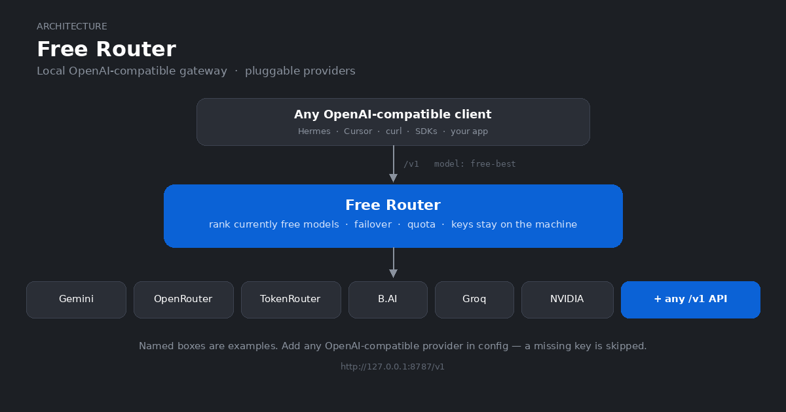
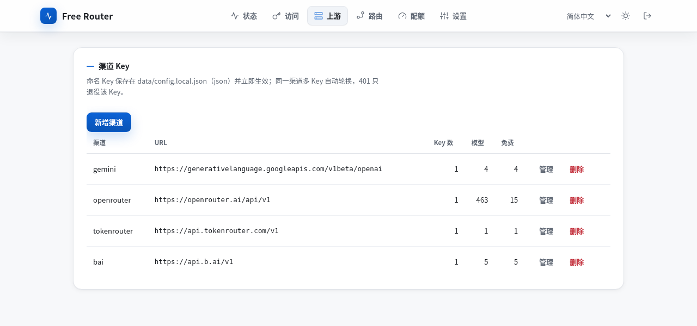
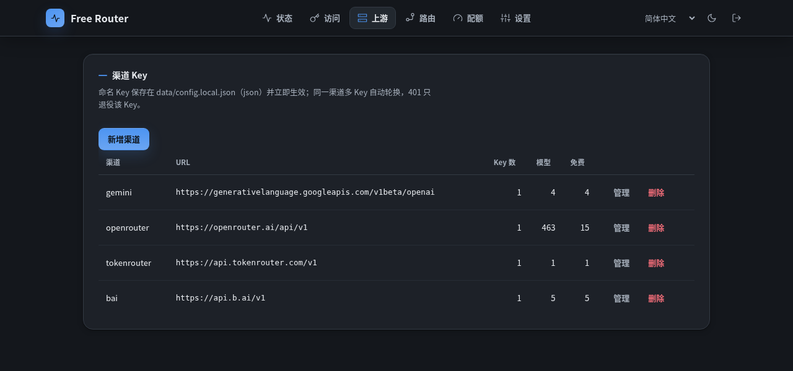
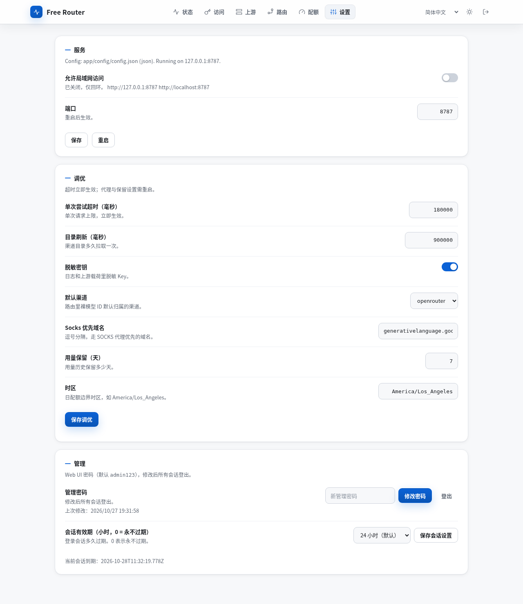
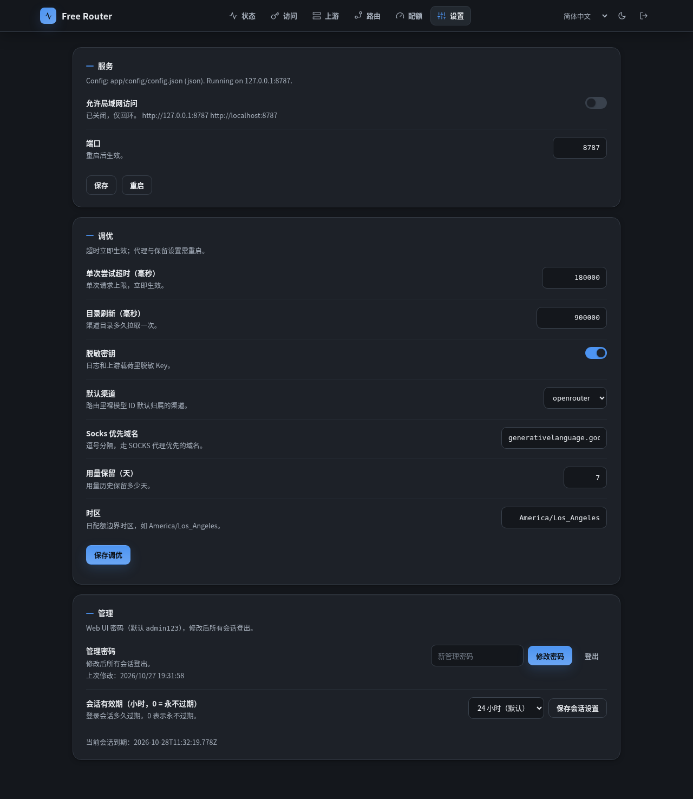

# Free Router Plus

> [English](../../README.md) | 中文

<p align="center">
  
</p>

把散落在各家的**免费大模型**，拼成一个**用不完、打不挂**的 OpenAI 接口。任意客户端指向它，只调 `free-best`：模型限流、宕机、额度烧完，它自动换下一个顶上。

- **零依赖**：纯 Node 标准库，没有 `npm install`，没有供应链包袱。
- **开箱即用**：首次启动自己生成默认配置，打开浏览器就能配。
- **Key 自由**：同一渠道多 Key 自动轮换，401 只退役坏的那一把。
- **额度透明**：免费配额按天跟踪，烧完的模型自动让路，第二天回来。
- **局域网就绪**：一键开关 + 网关鉴权，手机、平板、家里其他机器都能用。
- **讲你的语言**：12 种界面语言，跟随浏览器自动切换。
- **明暗双主题**：默认跟随系统，也可在顶栏锁定浅色或深色。

## 界面截图

Web UI 自带浅色与深色主题，顶栏按钮按 跟随系统 → 浅色 → 深色 循环。除标注"需重启"的设置外，改动立即对运行中的进程生效。

| 渠道 · 浅色 | 渠道 · 深色 |
| :---: | :---: |
|  |  |

| 设置 · 浅色 | 设置 · 深色 |
| :---: | :---: |
|  |  |

## 目录

- [界面截图](#界面截图)
- [60 秒上手](#60-秒上手)
- [Docker 部署](#docker-部署)
- [它在背后做什么](#它在背后做什么)
- [进阶](#进阶)
- [Key 去哪领](#key-去哪领)
- [`.env`（可选）](#env可选)
- [开发](#开发)
- [上游与 fork](#上游与-fork)

## 60 秒上手

```bash
git clone https://github.com/sitaoo/free-router.git
cd free-router
./ctl.sh start          # 只要 Node 20+，无其他依赖
```

打开 <http://127.0.0.1:8787/>，默认密码 `admin123` 登录。去**渠道**页粘贴至少一个 Key，然后：

```bash
curl http://127.0.0.1:8787/v1/chat/completions \
  -H 'Content-Type: application/json' \
  -d '{"model": "free-best", "messages": [{"role": "user", "content": "hi"}]}'
```

通了。路由排序、配额、局域网、网关 Key，剩下的全在 UI 里点。`./ctl.sh stop` 停止，`./ctl.sh status` 看状态。

## Docker 部署

仓库自带 Compose 配置，应用镜像直接从源码构建，不需要拉预构建的应用镜像；基础镜像 `node:20-slim` 来自 Docker Hub。

```bash
git clone https://github.com/sitaoo/free-router.git
cd free-router
mkdir -p data && cp .env.example data/.env
# 首启前编辑 data/.env，这三项在 Docker 里都必填：
#   FREE_ROUTER_HOST=0.0.0.0
#   FREE_ROUTER_WEBUI_PASSWORD=<新的管理密码>
#   FREE_ROUTER_API_KEY=<给客户端用的网关 Key>
./ctl.sh docker                             # 等价于 docker compose -f docker/compose.yaml up -d
```

打开 <http://127.0.0.1:8787/>，用 `data/.env` 里的管理密码登录；客户端用同一个文件里的网关 Key 调用。

发布端口只能转发到监听 `0.0.0.0` 的进程，所以种子里的 `FREE_ROUTER_HOST` 必须这样写。这个绑定同时接受局域网连接，而服务在管理密码仍是 `admin123` 或没有任何网关 Key 时会拒绝启动；上面三项正好满足检查，也不会让 `/v1` 裸奔。种子只在首启读取；之后在 UI 里改密码和 Key，或在 设置 → 允许局域网访问 里改监听地址（需要重启，`restart: unless-stopped` 会把容器拉回来）。Compose 的端口映射默认发布到所有宿主机网卡；只在本机用可改成 `127.0.0.1:8787:8787`。

容器发布 `8787:8787`，把 `./data` 挂载到 `/srv/free-router/data`；`restart: unless-stopped` 会在重启后自动拉起容器，这个挂载让 Provider Key、网关 Key、发现状态和覆盖配置在重建容器后都还在。应用镜像由 [docker/Dockerfile](docker/Dockerfile) 的 `node:20-slim` 构建，`.dockerignore` 保证运行时数据不会进入镜像。

```bash
./ctl.sh docker ps
./ctl.sh docker logs -f
./ctl.sh docker down
./ctl.sh docker up -d --build   # 改代码后重建
./ctl.sh docker --dev           # 开发：只读挂载整个仓库
```

细节：[Docker 运行](HOW_IT_WORKS.md#docker-运行)。

## 它在背后做什么

- **每两天自动发现**：扫描各渠道目录，新出现的免费模型先做一套能力实测，够格才进榜。
- **每次请求现场排名**：配置顺序定起跑线，真实成功率、冷静期、日限额实时加权，pinned 模型永远先上。
- **0-100 打分尺度**：画像加成、稀缺让路、实时延迟微调排序，百分之几的流量探冷模型。详见[打分尺度与实时信号](HOW_IT_WORKS.md#打分尺度与实时信号)。
- **坏 Key 不连坐**：401 只退役当前 Key，限流只冷却当前 Key，从不给模型记黑账。
- **配置丢不了**：出厂默认和你的改动分文件存放，`git pull` 永远冲不掉设置。
- **跑在哪都行**：裸机前台、`systemd` 常驻、Docker Compose，数据全在 `data/` 这一个目录里。

## 进阶

```bash
./script/models.sh          # 当前 free-best 实时榜
./script/models.sh --usage  # 谁烧了多少配额
./ctl.sh docker --dev       # Docker 开发模式（代码热挂载）
```

- 局域网：设置 → **允许局域网访问**，按页面的地址列表连，记得先建网关 Key、改密码。
- 加新渠道：Web UI 里填名字和 base URL，或往 `app/config/config.json` 加一段。
- 原理与配置分层：[工作原理](HOW_IT_WORKS.md)。

## Key 去哪领

| 变量 | 获取位置 |
| --- | --- |
| `GEMINI_API_KEY` | [Google AI Studio](https://aistudio.google.com/apikey) |
| `OPENROUTER_API_KEY` | [openrouter.ai/keys](https://openrouter.ai/keys) |
| `TOKENROUTER_API_KEY` | TokenRouter |
| `BAI_API_KEY` | [chat.b.ai](https://chat.b.ai) |
| `HASHNEURON_API_KEY` | HashNeuron（`https://hashneuron.space/v1`） |

命名规则：`FOO_API_KEY` + `FOO_BASE_URL`，任意兼容 OpenAI 的渠道照此即用，多 Key 逗号分隔。

## `.env`（可选）

Web UI 是主要配置方式，`.env` 只是便利种子。`mkdir -p data && cp .env.example data/.env`，填上 Key。局域网（以及 Docker 发布端口）再加 `FREE_ROUTER_HOST=0.0.0.0`。首启内容会被迁移进 `data/config.local.json`，之后 `.env` 彻底忽略，UI 改的一定生效。显式进程环境变量永远最高。Provider Key 也可以直接走环境变量，Key 可以完全不落文件。

## 开发

```bash
npm test       # 单元 + 冒烟测试
npm run check  # 全文件语法检查
```

`main` 镜像上游，`plus` 是本版主干。功能分支短命，用完快进合入即删。

## 上游与 fork

Fork 自 [www222fff/free-router-proxy](https://github.com/www222fff/free-router-proxy)（上游：代码、issue、[文档站](https://www222fff.github.io/free-router/)）。本 fork（`plus` 版）保留局域网访问，并新增：结构化 `app/` 布局、`data/` 唯一运行时目录、`ctl.sh` 总入口、加固过的鉴权、会学习的排序管线。适合双边的上游 PR（如目录结构）会再提回去。
